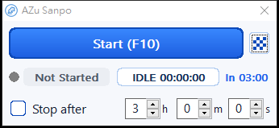

# Rust migration verification — 2026-11-03

The application is now Rust with native Win32 controls, hooks and input APIs.
The C# project, implementation and test runner have been removed. The release
does not need .NET, a WebView, or third-party runtime DLLs.

## Measured delivery and startup

| Measurement | C# v1.0.1 | Rust |
| --- | ---: | ---: |
| EXE bytes | 71,855,237 | 354,304 |
| Warm startup median | 226.58 ms | 22.60 ms |

EXE size fell **99.51%**. Warm startup was **10.0× faster** on this machine.
These are warm process launches, not cold boot or first-download measurements:
one warmup per executable, then ten launches each in alternating order, measuring
process start until its main window is visible. Measurements include PowerShell
`Start-Process` overhead and can vary with Windows, hardware and antivirus state.

Raw samples and hashes: `artifacts/startup-benchmark.json`.
The final Rust EXE is `artifacts/hit-target-final/MouseMoverApp.exe`.
SHA-256: `998fd3f6f4b61afe77325e432fe6e82a411d3d32660d03540c8bf7467b8fa26d`.

The 340×130 client has three rows: a gradient blue button and checkerboard
background toggle; a lamp, state badge, IDLE HH:MM:SS and In 03:00;
then a 20px native checkbox with 12pt normal-weight caption and h/m/s fields.
The redundant Status prefix is removed. Countdown feedback is integrated into
the checkbox caption. Transparent mode removes all text and badge backplates,
using outlined floating text; the blue button, checkbox and input boxes stay opaque.
Status and In text are vertically aligned. Preview:



## Verification

- `cargo fmt --check`: passed.
- `cargo test --locked`: fifteen passed, zero failed (ten core, five native/UI).
  Includes the complete 446-point
  path fixture generated from the old C# release implementation, idle/countdown
  transitions, hours/minutes/seconds conversion, injected-input flag filtering and
  worker cancellation replacement.
- Presentation checks cover IDLE total hours, the In threshold at 179/180/181
  seconds and all inline countdown captions. Native memory-DC pixels confirm the
  checkbox uses BM_GETCHECK instead of misleading draw flags; restoring the old
  flag read made the regression fail. Native layered-window properties confirm
  per-pixel alpha mode and restoration of the original style.
- Native regression: 100 monitoring input events advance the input timestamp
  without text writes or control invalidations. A Win32 subclass also verifies
  duplicate text is not rewritten. Restoring the old unconditional refresh caused
  the regression to fail before restoring the fix.
- `cargo clippy --locked --all-targets -- -D warnings`: passed.
- `scripts/publish.ps1 -OutputDirectory artifacts/hit-target-final`: passed; standalone
  EXE, two UTF-8 instruction TXT files, and SHA-256 output produced.
- `scripts/check-ui.ps1 -Executable artifacts/hit-target-final/MouseMoverApp.exe`:
  passed. Checks topmost fixed window, 3/0/0 defaults, all three spinner buddies/ranges,
  Start/Stop, hours affecting countdown, countdown before Start, restart, zero
  duration and global F10. Also checks three rows, In 03:00 and IDLE HH:MM:SS,
  icon placement and accessible action name, native per-pixel transparency and
  restoration, and that changing the background preserves countdown and fields.
- `scripts/check-cutout.ps1 -Executable artifacts/hit-target-final/MouseMoverApp.exe`:
  passed on an unlocked Windows desktop. Checks actual DWM-composited pixels over
  disposable black and white fixture windows: former text/badge/caption/icon
  background positions match the backdrop, while input boxes remain opaque.
  These captures contain only the app and controlled fixture, not user desktop content.
- `scripts/check-hit-targets.ps1`: checks every pixel in button, checkbox, icon,
  edit and spinner targets (excluding the native spinner/edit overlap), then
  exercises real mouse clicks in both background modes. Includes the main
  button's corners, blank checkbox-caption areas, rapid repeated clicks,
  keyboard Space, spinner increments/decrements, and background click-through.
  The prior release fails at the blank checkbox area and transparent button
  corner; the initial notification-gated fix failed the rapid-click regression.
- Transparent mode uses an almost invisible alpha of 1/255 inside interactive
  padding so clicks reach the full control. Other empty cutouts retain alpha zero.
  Its GDI-rendered title bar uses the basic Windows frame appearance.
- Native render captured and visually inspected for readable text, unclipped
  bounds, consistent light backgrounds and aligned duration fields, including
  `999h 59m 59s` at the enlarged font size.
- PE import inspection: x64 Windows GUI subsystem; only Windows system DLLs
  (`kernel32`, `msvcrt`, `ntdll`, synchronization API set, `comctl32`, `gdi32`,
  `msimg32`, `user32`).

Build environment: Rust 1.99.1, x86_64-pc-windows-gnu, compatible x64 MinGW-w64.
The native smoke test does not wait three real minutes or generate a full cursor
trace/click cycle on the desktop; those timing/state/path rules are covered by
deterministic tests and source review. Remote CI results are available in GitHub
Actions for the uploaded commit.

## Reproduce

```powershell
cargo fmt --check
cargo test --locked
cargo clippy --locked --all-targets -- -D warnings
./scripts/publish.ps1 -OutputDirectory artifacts/new-release
./scripts/check-ui.ps1 -Executable artifacts/new-release/MouseMoverApp.exe
./scripts/benchmark.ps1 -Baseline artifacts/v1.0.1/release/MouseMoverApp.exe -Candidate artifacts/new-release/MouseMoverApp.exe -Runs 10
```

Publishing intentionally requires an empty output directory. The benchmark needs
the prior release EXE and should run while no other instance owns global F10.
Use `-Screenshot artifacts/ui-rust-light.png` with `check-ui.ps1` to save the
application's own native window render for visual inspection.

Transparent-mode composition checks: [black backdrop](ui-transparent-dark.png),
[white backdrop](ui-transparent-light.png). Reproduce locally with
`./scripts/check-cutout.ps1 -Executable artifacts/new-release/MouseMoverApp.exe`.
